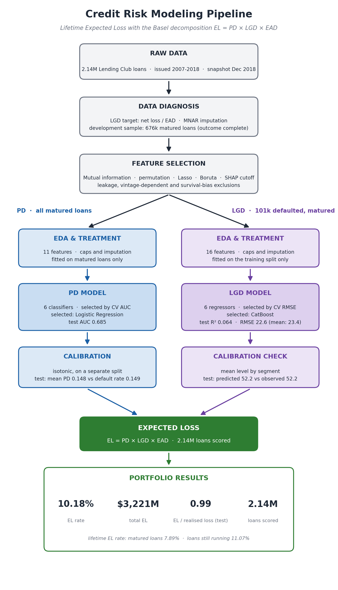
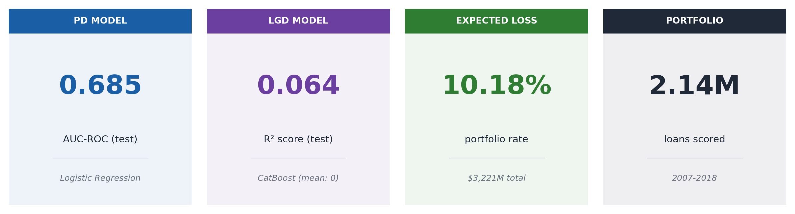
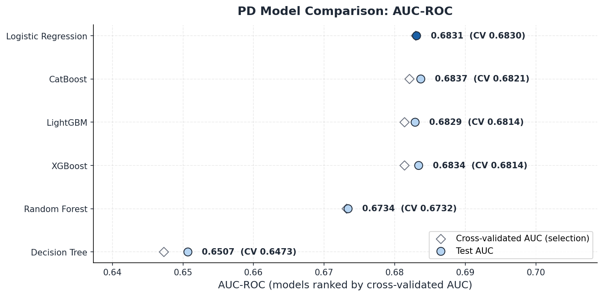
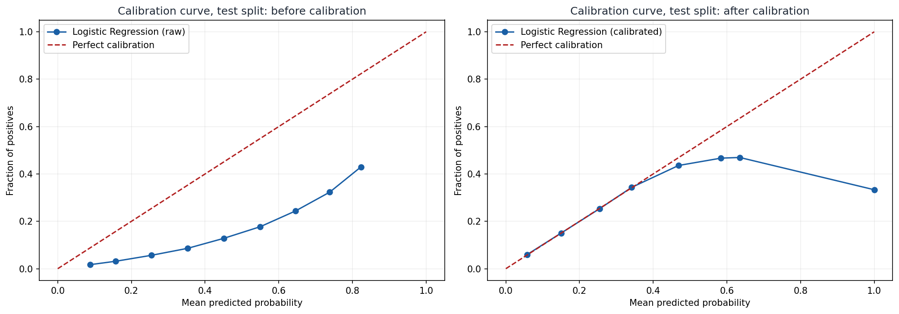
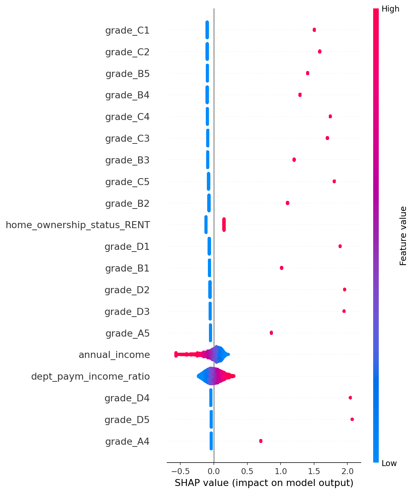
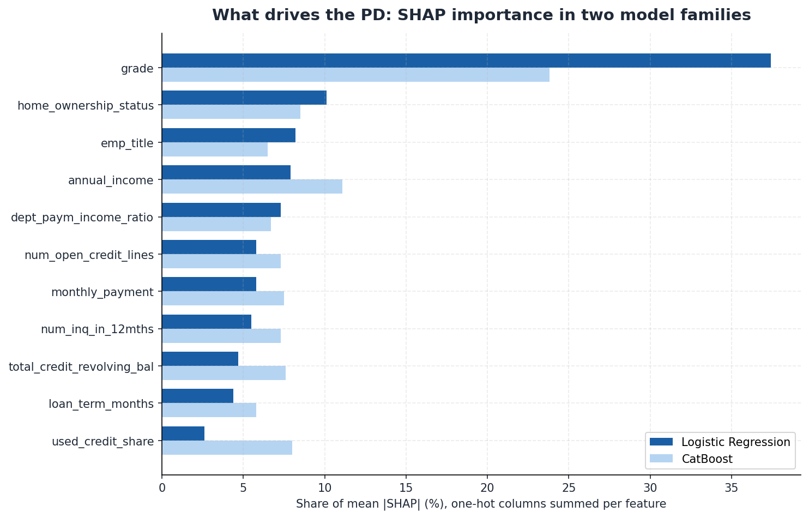
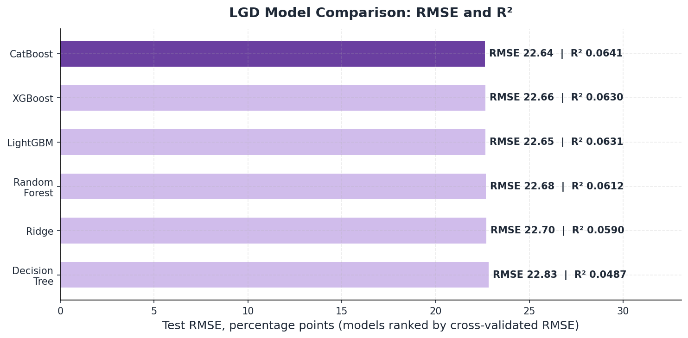
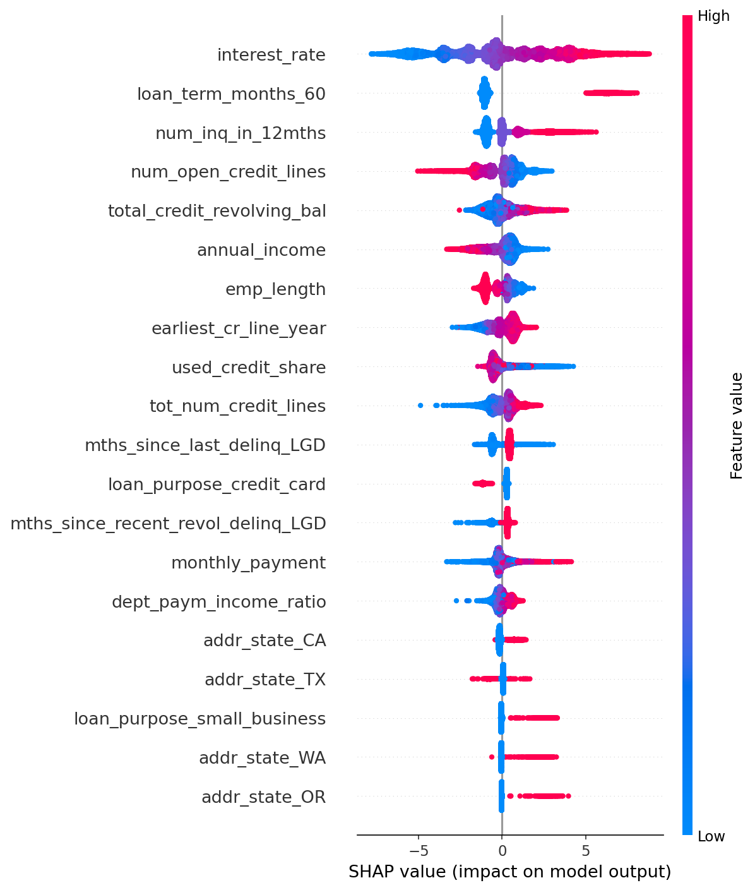
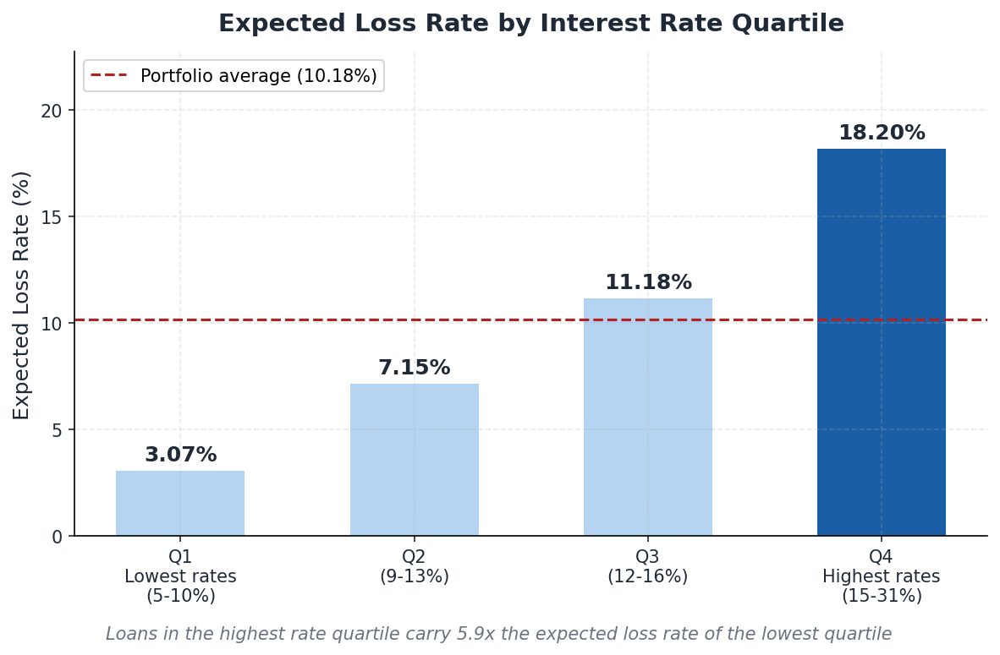

# A Deep Dive into Expected Loss through Credit Scoring Industry-Standard Machine Learning under Basel II/III

**An end-to-end credit risk pipeline on 2.1 million Lending Club loans: Probability of Default, Loss Given Default and Expected Loss for every loan in the portfolio, developed on loans whose outcome is known and validated against the losses they actually produced.**


---

## What this project does

Before buying or holding a loan portfolio, a lender needs to know how much it stands to lose. Under the Basel framework that loss is decomposed per loan:

```
Expected Loss = PD x LGD x EAD
PD  = probability that the borrower defaults
LGD = share of the exposure lost if they do
EAD = exposure at default (here, the amount funded)
```

The pipeline builds a PD model and an LGD model from application data, scores all 2.14 million loans and adds up the Expected Loss. Every number in this README is produced by the notebooks in `production_notebooks/`, including the charts.



---

## Results at a glance



The Expected Loss here is a **lifetime** figure: the loss expected over the whole life of each loan, not an annual rate. The check that matters is whether it matches reality where reality is known. On the matured loans, whose outcome is complete, the predicted loss is 99.3% of the loss they actually produced; on the test loans, which neither model saw, it is 98.8%.

| | Value |
|---|---|
| Loans scored | 2,139,643 (issued 2007-2018) |
| Total exposure (EAD) | $31.6bn |
| Total Expected Loss | $3,221M |
| Lifetime EL rate | 10.18% (matured loans 7.89%, loans still running 11.07%) |
| EL / realised loss, matured loans | 0.993 |
| EL / realised loss, test loans | 0.988 |

---

## The key design decision: learn only from loans whose story has ended

The data stops at December 2018. A loan issued in 2017 for 60 months is "not defaulted" only in the sense of "not defaulted yet". Training on it teaches a model that recent loans are safe, and the losses of recent defaults are still incomplete because recoveries take years.

So both models are developed on **matured** loans only (issue date + term before the end of the data): 676,113 loans, 100,589 defaults, default rate 14.9%. The fitted models then score **every** loan, matured or not, which is how a portfolio would actually be valued. The same reasoning removes ten bureau fields that Lending Club only reported from 2016: their missing values would tell the model the vintage, not the borrower.

---

## Probability of Default (PD)

Eleven application features (grade, income, debt-to-income, monthly payment, home ownership, employment, credit lines, recent enquiries, revolving balance, credit utilisation and loan term) feed six classifiers, each tuned with cross-validated random search. The model is chosen by **cross-validated** AUC; the test split never takes part in the choice.



Four models finish within 0.001 of AUC of each other, well inside the sampling error of the test AUC (about 0.003). The selection rule picks the **logistic regression** (CV AUC 0.6849, test AUC 0.6849), and on a tie that is also the right choice: it is the standard form of an application scorecard and every coefficient can be audited. Gradient boosting has little to add here because the strongest input, `grade`, is already Lending Club's own risk score, and the remaining features act mostly in one direction.

An AUC of 0.68 is modest, and it is the honest number for this setting: only application data, on a population that Lending Club had already screened (the rejected applicants are not in the data). An earlier version of this project reported 0.773; that figure came from training on immature vintages and on fields whose missingness revealed the vintage.

### Calibration

Ranking borrowers is not enough for Expected Loss: a PD of 0.30 has to mean a 30% chance of default. The models are trained with class weighting, which inflates their probabilities (mean 0.46 against a real default rate of 0.15). An isotonic calibrator, fitted on a dedicated calibration split with the trained model frozen, fixes the level without changing the ranking:

> Test split: mean PD **0.1485**, observed default rate **0.1488**. Brier score 0.226 before calibration, 0.120 after (0.127 for a constant PD at the default rate).



The calibration also holds by segment: by interest-rate quartile, and by term on the test split (36 months: 0.139 against 0.139; 60 months: 0.252 against 0.253). The term check is what caught a real problem: a first run whose feature selection had left `loan_term_months` out underestimated the PD of 60-month loans by 4 to 6 points in every vintage, so the term was added to the model.

### What drives the PD

SHAP values decompose every prediction into feature contributions (in log-odds for the logistic regression). The summary below shows the 20 most influential encoded columns on 50,000 test loans.



Because four models are tied, the explanation should not depend on which of them won. The same loans are explained with CatBoost (`TreeExplainer`), and the one-hot columns are summed back into their original feature:



Both families agree that `grade` dominates. Below it the importances are flat (3% to 11% each), so their order differs between models; CatBoost spreads more weight over continuous variables such as credit utilisation, where it can use non-linear shapes.

---

## Loss Given Default (LGD)

The LGD target is the net loss on a defaulted loan as a share of the amount funded: `(EAD - principal repaid - recoveries) / EAD`. Six regressors are trained on the 100,589 matured defaults and selected by cross-validated RMSE.



**CatBoost** is selected (test RMSE 22.6 points, R² 0.064). All six models are within 0.2 points of each other, and the dashed line shows what predicting the average LGD for everyone would give: 23.4. The model improves on that constant by less than a point.

### Why the LGD R² is so low

The target mixes two different things:

```
LGD = (1 - a) x (1 - r)
a = share of the loan already repaid when the borrower stopped paying
r = share of the remaining balance recovered after default
```

| Instalments paid before default | Loans | Mean LGD |
|---|---|---|
| 0 to 6 | 13,255 | 81.7% |
| 6 to 12 | 21,743 | 70.0% |
| 12 to 18 | 21,666 | 56.7% |
| 18 to 24 | 19,078 | 42.4% |
| 24 to 36 | 22,015 | 24.3% |

- **Timing decides the LGD.** The share repaid before default (`a`) explains 86% of the variance of the LGD on its own.
- **Timing cannot be read from an application.** The same features explain 7.6% of `a`: when a borrower stops paying depends on what happens after the loan is granted.
- **Recovery is nearly constant.** 86% of defaults recover less than 20% of what was still owed; the loss on the balance at default averages 87%, and the features explain essentially none of it (R² 0.006).

So the low R² is a property of the target on unsecured consumer loans, not a modelling failure, and more complex models would not change it. What the Expected Loss needs is the right **level** of LGD by segment, and that holds: mean predicted LGD 52.2% against 52.2% observed on the test defaults. Notebook `06_training_lgd` contains the full decomposition.

The regulatory alternative, proposed as the next step, is to separate the two parts as Basel IRB models do: EAD as the balance outstanding at default (an amortisation schedule evaluated at the expected default date) and LGD as the loss on that balance, close to a constant 87% for this portfolio.



---

## Expected Loss validation

1. **Against realised losses.** EL / realised loss is 0.993 on the matured loans and 0.988 on the test loans. The realised lifetime loss of the matured loans is 7.94% of their exposure; the model gives 7.89%.
2. **By term.** 36-month loans 7.13%, 60-month loans 15.01%.
3. **By interest rate.** The EL rate rises from 3.1% in the lowest-rate quartile to 18.2% in the highest, and the mean PD matches the observed default rate in each quartile of the matured loans.



4. **Loans still running carry a higher EL rate (11.1% against 7.9%).** Mostly composition: 37% of the running loans are 60-month loans against 8% of the matured ones, and they have weaker grades. Within the same term and grade the gap is smaller but still positive in 13 of the 14 cells: the models only see application features, and the recent applications are weaker on average even within a grade. The vintages close to maturity have already reached their predicted default rate, so if anything their EL is understated (see the limitations).

---

## What this project does beyond a typical notebook

- **Survival bias handled explicitly:** development on matured loans, vintage-dependent fields excluded, every loan scored.
- **No post-origination information** in any feature; payment and recovery variables only define the targets.
- **Model selection by cross-validation**, calibration on its own split, test split untouched until the end.
- **Calibration checked by segment** (rate quartile, term, vintage), which caught and fixed the 60-month bias.
- **Honest diagnosis of a weak model:** the LGD R² is decomposed into its causes instead of being hidden or inflated.
- **SHAP across model families** to show that the explanation does not depend on which tied model won.
- **Reproducible engineering:** treatment rules as fitted specifications, a shared LGD pipeline for training and scoring, unit tests for `src/`, and README charts drawn by the notebooks.

---

## Project structure

```
repo/
    original_notebook/
        CreditScoring_ExpectedLossCalculation.ipynb   # archived first version, with all outputs
    production_notebooks/
        01_data_diagnosis.ipynb       # targets, matured flag, feature engineering
        02_feature_selection.ipynb    # exclusions, MI / permutation / Lasso / Boruta, SHAP cutoff
        03_eda_pd.ipynb               # PD feature treatment
        04_eda_lgd.ipynb              # LGD feature treatment
        05_training_pd.ipynb          # 6 classifiers, calibration, SHAP, portfolio scoring
        06_training_lgd.ipynb         # 6 regressors, LGD decomposition, portfolio scoring
        07_expected_loss.ipynb        # EL, validation, segment and vintage checks, README charts
        TECHNICAL_README.md           # inputs, outputs and decisions of every notebook
    src/                              # feature selection, treatment, pipelines, training, SHAP, charts
    tests/                            # unit tests for src/ (pytest)
    assets/                           # README charts, written by the notebooks
    requirements.txt
```

`production_notebooks/TECHNICAL_README.md` documents each notebook and lists what changed from the original notebook.

---

## How to run it

```bash
git clone https://github.com/JuanGarridoGarcia/A-Deep-Dive-into-Expected-Loss-through-Credit-Scoring-Industry-Standard-Machine-Learning
cd A-Deep-Dive-into-Expected-Loss-through-Credit-Scoring-Industry-Standard-Machine-Learning
pip install -r requirements.txt
```

1. Download the [Lending Club loan data (cleared)](https://www.kaggle.com/datasets/db0boy/lending-club-loan-data-cleared/data) from Kaggle and place `X.csv` and `target.csv` in `data/raw/`.
2. Run the notebooks in order, 01 to 07, from the repository root or from `production_notebooks/`. Each reads its inputs from `data/processed/` and writes its outputs there. A full run takes about three hours on a 16-core desktop, most of it the PD hyperparameter search.

Unit tests:

```bash
pip install -r requirements-dev.txt
pytest
```

---

## Limitations

This is a portfolio project, not a production banking model. The main limitations:

- **No out-of-time validation.** The splits are random within the matured loans. Lending Club's 2015-2016 vintages performed worse than earlier ones with the same application profile, and the running loans close to maturity have already reached their predicted default rate, so the EL of the loans still running is more likely understated than overstated. A vintage adjustment (survival curves of early defaults by cohort) is the natural next step.
- **LGD structure.** The LGD is measured against the amount funded, which mixes default timing with recovery (see above). The Basel structure, EAD at default plus LGD on that balance, is the proposed improvement.
- **EAD is the amount funded.** It ignores amortisation before default; that effect sits inside the LGD instead.
- **PD floor not applied.** Isotonic calibration assigns a PD of exactly 0 to some loans. Basel IRB floors the PD at 0.05% (final Basel III reform, implemented in the EU by CRR3; 0.03% under Basel II).
- **No downturn adjustment.** Through-the-cycle estimates, not the downturn LGD required for regulatory capital.
- **Approved loans only.** Rejected applicants are not in the data (no reject inference), which caps the achievable discrimination.
- **Application data only.** No behavioural variables (payment history, balance evolution), which production models rely on.
- **Gross recoveries.** Collection fees are not in the data, so the LGD is slightly understated.

---

## Tech stack

Python 3.13, pandas, NumPy, scikit-learn, XGBoost, LightGBM, CatBoost, SHAP, Boruta, matplotlib, pytest
